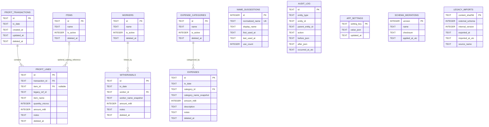

# مخطط علاقات قاعدة بيانات MowxBack

## ملاحظات على العلاقات

- علاقة رأس حركة الأرباح إلى السطور واحد إلى متعدد، ولا تنشأ حركة أرباح من دون سطر فعال في التقارير.
- علاقة `profit_lines.item_id` اختيارية فقط. اسم الصنف الحر محفوظ في السطر نفسه، لذا لا يتطلب سجل إدارة أصناف.
- المصروف مرتبط بتصنيف عبر FK، والسحبية مرتبطة بعامل عبر FK.
- جداول الإدارة لا تملك علاقة مباشرة مع الاقتراحات؛ `name_suggestions` قاموس مستقل.
- `audit_log` يسجل أنواع الكيانات والمعرفات السابقة/اللاحقة كـ snapshots JSON؛ هذه علاقة تدقيق مرنة وليست بديلاً عن مفاتيح المعاملات المالية.
- Views `v_all_transactions` و`v_daily_totals` و`v_profit_by_item` وملخص التصنيف والعامل هي طبقة عرض للحساب، وليست جداول إضافية.
